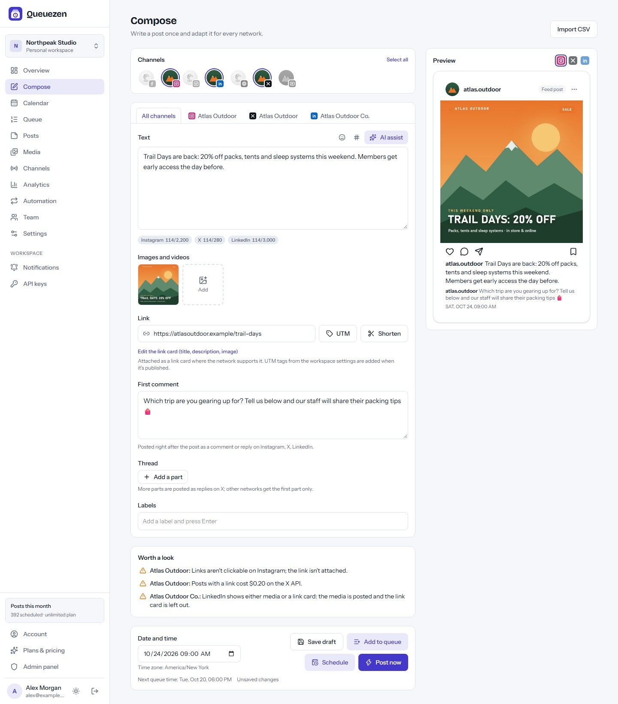
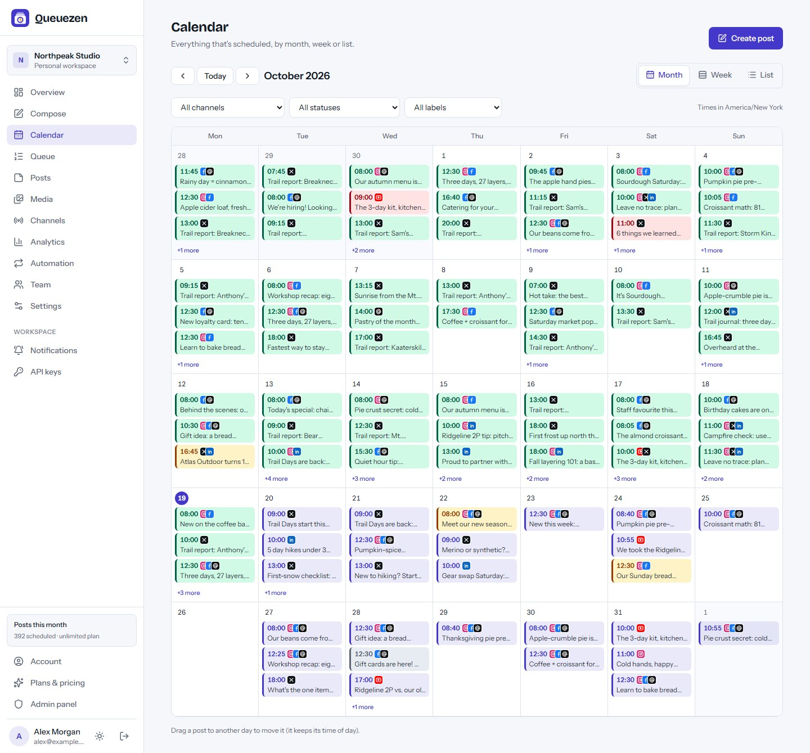
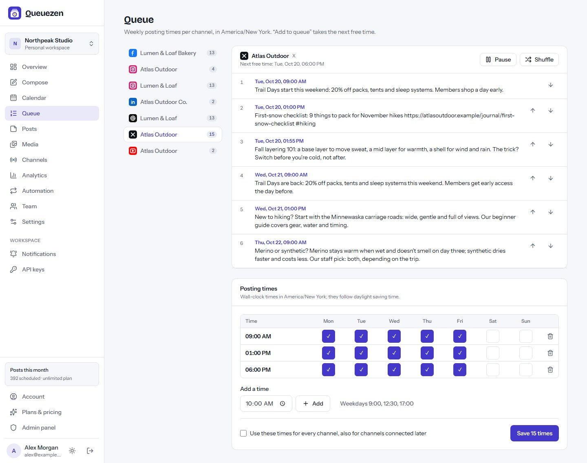
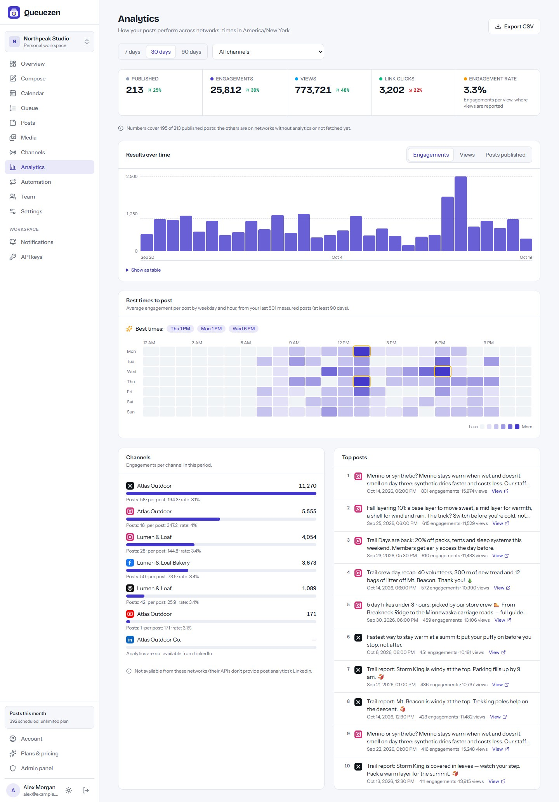
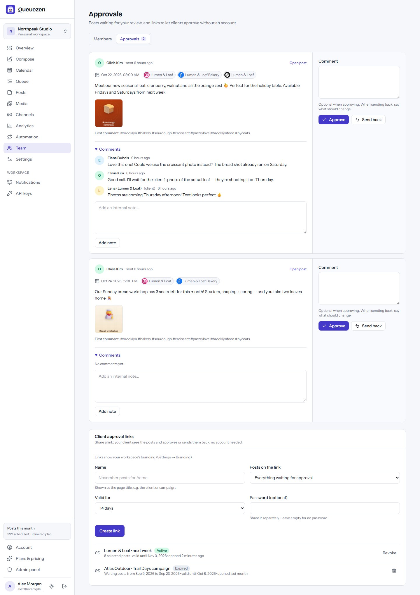
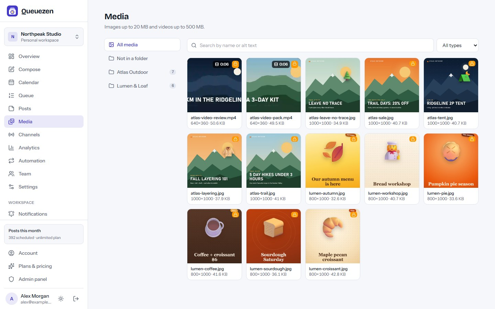
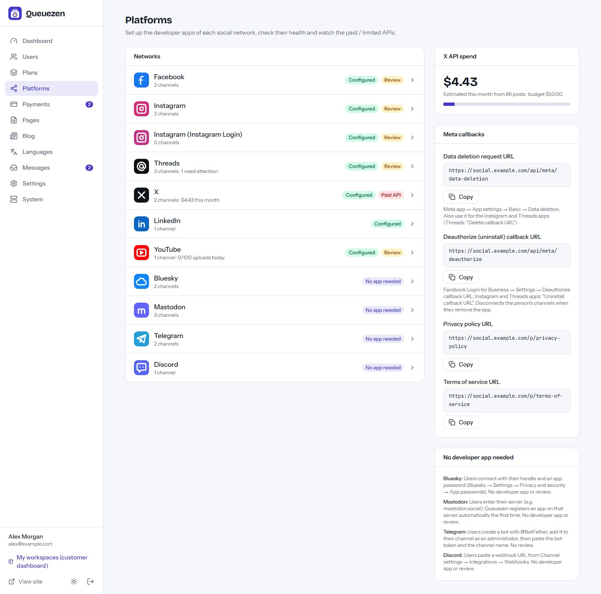

# Queuezen

**Open-source social media scheduler — run your own Buffer / Hootsuite-style SaaS.** Plan, approve
and publish posts on 10 networks from one composer. Built with Next.js 16, React 19 and Tailwind
CSS 4. Runs on a VPS, Docker, cPanel (Node.js) or Vercel, with MySQL/MariaDB or a zero-setup
SQLite database.

**Live demo:** https://queuezen-demo.vercel.app — log in with `demo@queuezen.app` / `demo12345`
(data resets regularly; the demo publishes to simulated networks).



## Features

- **10 networks through their official APIs:** Facebook Pages (feed, Reels, Stories), Instagram
  with Facebook Login or Instagram Login (feed, carousels, Reels, Stories), Threads, X, LinkedIn
  profiles, YouTube and Shorts, Bluesky, Mastodon, Telegram channels/groups and Discord webhooks.
  No scraping, no browser automation, no social media SDKs.
- **Composer:** one shared version plus per-channel overrides, live previews, network-accurate
  character counters and validation, threads, first comments, link cards, hashtag groups, labels
  and autosave.
- **Scheduling:** pick a date, use per-channel queue slots or post now; calendar (month, week,
  list) with drag and drop; queue reorder, shuffle and pause; bulk CSV import.
- **Reliable publishing engine:** leases, resumable uploads, lookup before retry (no duplicate
  posts), automatic retries, token refresh and re-auth reminders.
- **Teams and approvals:** workspaces per brand or client, roles (owner, admin, editor, approver,
  viewer), approval workflow with comments and password-protected client approval links.
- **Automation:** RSS / Atom auto-posting, evergreen recycling, tracked short links and automatic
  UTM tags.
- **Analytics:** top posts, per-channel results, link clicks, best-time heatmap and CSV export.
- **AI assistant** with your own OpenAI-compatible or Anthropic key.
- **Media library** on local disk, S3-compatible storage or Vercel Blob, with direct browser
  uploads, folders and alt text.
- **Notifications** by email, Slack, Discord, Microsoft Teams, Telegram and signed webhooks, plus
  a **REST API** for channels, posts, approvals, media and analytics.
- **SaaS ready:** plans with channel, post, seat, X and AI limits; Stripe / PayPal / Razorpay /
  bank transfer payments; a per-network setup wizard in the admin panel, a blog and content pages.
- **Multi-language** with right-to-left support (Arabic and Hindi packs included).
- **Web installer** for MySQL or SQLite, plus PM2 and Docker configurations.

| Calendar | Queue time slots | Analytics |
| --- | --- | --- |
|  |  |  |
| **Approvals** | **Media library** | **Admin → Platforms** |
|  |  |  |

More screenshots are in [`marketing/final/screenshots`](marketing/final/screenshots).

## Hosted version & paid installation

Need Queuezen hosted for you, installed on your own server, or customised? Contact
**[EpiFive](https://www.epifive.com/services)**.

More open-source projects: https://www.epifive.com/open-source

## Quick start

```bash
git clone https://github.com/epifive/queuezen.git
cd queuezen/app
npm install
npm run dev
```

Open http://localhost:3000 — you are redirected to the web installer at `/install`. Choose
**SQLite** for a zero-setup local database, or **MySQL/MariaDB** for production.

On `localhost` the big networks can't redirect OAuth sign-ins back to you, so switch on
**Admin → Platforms → Simulated platforms** to try everything (Bluesky, Mastodon, Telegram and
Discord work for real from localhost). Scheduled posts go out on time when the worker
(`CRON_SECRET=… npm run worker`) or a cron job calls the scheduler every minute.

Production, Docker, PM2, cPanel and Vercel setups, the developer apps for each network, media
storage and every setting are covered in [`app/README.md`](app/README.md) and the full guide in
[`documentation/index.html`](documentation/index.html) (open it in a browser).

**Requirements:** Node.js 20.9+ (22.13+ for SQLite), MySQL 5.7+ / MariaDB 10.3+ or SQLite, HTTPS on
a public domain (OAuth redirect URIs), a 1-minute scheduler (cron URL or worker), and your own
developer apps for the networks you offer.

The network drivers follow each platform's documented API and are tested with mocks and the
Simulated driver; please [open an issue](https://github.com/epifive/queuezen/issues) if a network
doesn't behave with a live account.

## Repository layout

| Path | What |
| --- | --- |
| `app/` | The Next.js application (dashboard, composer, publishing engine, admin, installer, worker) |
| `documentation/` | Full user and admin guide (single HTML file) |
| `marketing/final/` | Screenshots |

## Contributing

Bug reports and pull requests are welcome — please open an
[issue](https://github.com/epifive/queuezen/issues) first for larger changes. Run
`npm run lint`, `npm run typecheck` and `npm run build` in `app/` before sending a PR.

## License

[MIT](LICENSE) © 2026 EpiFive
